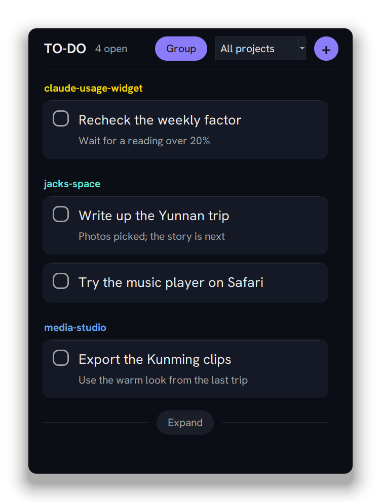
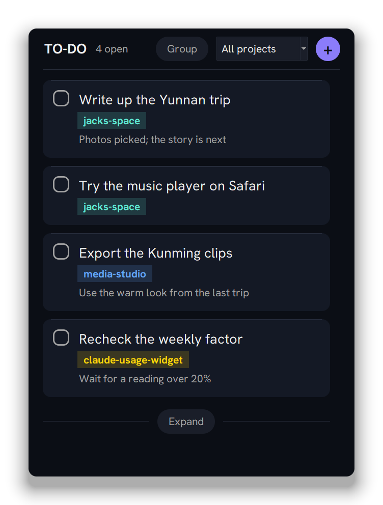
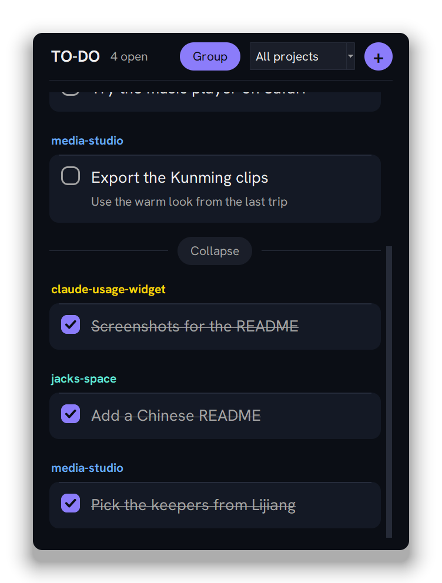
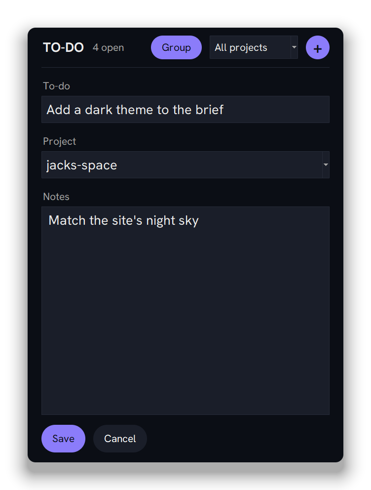
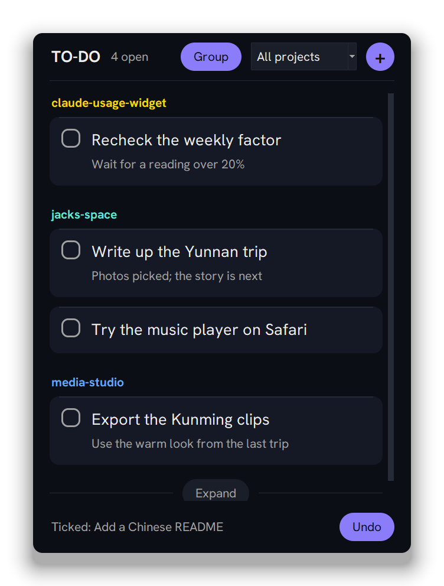

<div align="center">

# To-do widget

**English** | [简体中文](README.zh-CN.md)

A small to-do list on your Windows desktop that Claude can write to:<br>it adds items when you ask, and ticks them off when their work is pushed.



</div>

## What it looks like

<table>
  <tr>
    <td align="center" width="25%"></td>
    <td align="center" width="25%"></td>
    <td align="center" width="25%"></td>
    <td align="center" width="25%"></td>
  </tr>
  <tr>
    <td align="center"><b>One list</b><br>Group off: oldest first, each with its project.</td>
    <td align="center"><b>Done</b><br>Expand shows what's ticked, the latest first.</td>
    <td align="center"><b>Add</b><br>The to-do, its project and notes.</td>
    <td align="center"><b>Undo</b><br>For 5 seconds after a tick.</td>
  </tr>
</table>

## Features

- **Claude keeps it up to date.** Any Claude Code session can add or tick a to-do with one command; the widget shows it within 2 seconds.
- **Every project its own colour,** on its heading and its tag. The box at the top shows all projects or just one.
- **Stays out of the way.** It sits on the desktop behind your windows, comes forward on Win+D, and stays out of the taskbar and Alt+Tab.
- **Nothing to install.** Python and tkinter only, no packages. Your list is one file, `data\todos.json`.

## Quick start

In PowerShell, from this folder:

```powershell
pythonw widget.py
```

Click **+** to add a to-do (Enter saves, Esc cancels) and click its box to tick it. Drag the header to move it; right-click the header to exit.

Add or tick from Claude, or from any terminal:

```powershell
python C:\path\to\todo-widget\todos.py add jacks-space 'Write up the trip' --notes 'Photos picked'
python C:\path\to\todo-widget\todos.py done jacks-space 'Write up the trip'
```

To start the widget when you sign in to Windows:

```powershell
python startup.py
```

<details>
<summary><b>Using it</b></summary>

- **Add:** click **+**, type the to-do, pick or type a project, and add notes if you like. In a one-project view, the project is filled in for you. The Project box suggests your project folders (any folder next to this one with a CLAUDE.md, README.md or TESTING.md) and the names you've used; any name works.
- **Tick:** click the box. Ticked items move below a line, struck through, the latest first; **Expand** shows them and **Collapse** hides them, and the widget always starts with them hidden. A week after its tick, an item moves to `data\archive.json`, which keeps it.
- **Edit or delete:** click the item. Delete asks for a second click.
- **Grouped or one list:** click **Group** in the header. The widget starts the way you left it, where you left it.

</details>

<details>
<summary><b>Adding or ticking from a Claude session</b></summary>

Use the full path, so it works from any folder, and the session's project folder name as the project. `add` prints `Added to jacks-space: …`; `done` needs the exact text of one open item and prints `Ticked in jacks-space: …`. If the file can't be read, or no single item matches, it prints `Not added: …` or `Not ticked: …` and changes nothing.

In PowerShell, wrap the text in single quotes and double any single quote inside it (`'Jack''s list'`).

</details>

<details>
<summary><b>Start with Windows</b></summary>

`python startup.py` puts a shortcut named `To-do widget` in your Startup folder (Win+R, `shell:startup`). Delete it to stop.

The shortcut runs `To-do.exe`, a renamed copy of Python's `pythonw.exe`, so Task Manager lists the widget as "To-do". It still runs `widget.py` from this folder, so a code change needs only a restart. Reinstalling Python or moving this folder breaks it: exit the widget and run `python startup.py` again. Only one copy runs at a time.

</details>

<details>
<summary><b>Development</b></summary>

| Command | Does |
|---|---|
| `python -m unittest discover -s tests` | Run the tests |
| `python scratch\shoot.py .github\readme` | Remake these screenshots, from a copy of the widget with test to-dos |

The text is in Hanken Grotesk (SIL Open Font License), loaded from `fonts\` for the widget only; without it, Segoe UI. It shares its look with the [Claude usage widget](https://github.com/jacklee981229/claude-usage-widget).

</details>
